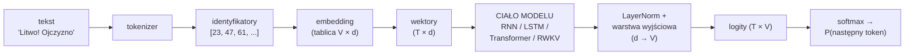
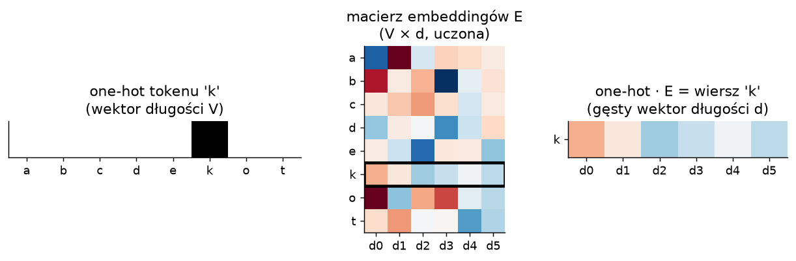
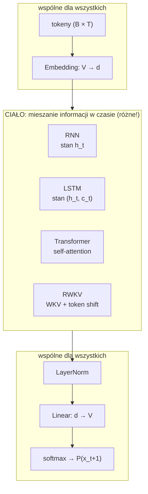
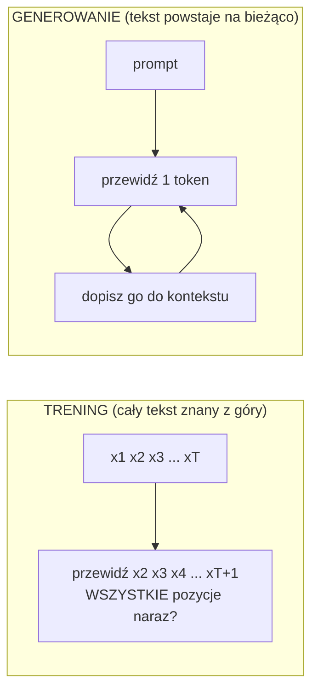

# 0. Jak sieć neuronowa w ogóle "czyta" tekst?

> Notebook do tego rozdziału: [`00_tekst_tokeny_embeddingi.ipynb`](00_tekst_tokeny_embeddingi.ipynb)

Zanim porównamy RNN, LSTM, Transformera i RWKV, trzeba odpowiedzieć na pytanie, które często umyka:
**jak w ogóle wrzucić tekst do sieci neuronowej?** Dobra wiadomość: ta część jest **identyczna**
dla wszystkich czterech architektur. Różnią się tylko "środkiem", czyli tym, jak model przenosi informację
między pozycjami w tekście.

## 0.1. Problem: sieci liczą na wektorach, a tekst to ciąg symboli

Sieć neuronowa to w gruncie rzeczy ciąg mnożeń macierzy i nieliniowości. Potrzebuje liczb
(a dokładniej wektorów liczb rzeczywistych), żeby dało się liczyć gradienty. Tekst to ciąg symboli.
Trzeba więc dwóch kroków:

1. **Tokenizacja**: tekst → ciąg liczb całkowitych (identyfikatorów tokenów).
2. **Embedding**: każdy identyfikator → gęsty wektor liczb rzeczywistych.

## 0.2. Tokenizacja: na jakie kawałki ciąć tekst?

Są trzy popularne podejścia:

| poziom | przykład dla "Ojczyzno moja" | rozmiar słownika V | zalety / wady |
|---|---|---|---|
| znaki | `O`,`j`,`c`,`z`,`y`,`z`,`n`,`o`,` `,`m`,... | ~100 | prosto, brak nieznanych słów; ale sekwencje są długie |
| słowa | `Ojczyzno`, `moja` | 100 000+ | krótkie sekwencje; ale ogromny słownik i problem z nowymi słowami |
| podsłowa (BPE) | `O`,`jczy`,`zno`,` moja` | 30 000–100 000 | kompromis, standard w LLM-ach |

**BPE** (*Byte Pair Encoding*, [Sennrich i in., 2016](https://arxiv.org/abs/1508.07909)) zaczyna od znaków
i wielokrotnie skleja najczęściej występującą parę sąsiednich symboli w nowy token. Częste słowa stają się
pojedynczymi tokenami, rzadkie rozpadają się na kawałki.

Modele RWKV-4 z paperu (trenowane na zbiorze *the Pile*) używają tokenizera BPE z GPT-NeoX-20B,
ze słownikiem **V = 50 277** tokenów, czyli tego samego co Transformery Pythia, z którymi są porównywane.
**W tym tutorialu używamy tokenizacji znakowej** (V = 87 dla "Pana Tadeusza"), bo daje sensowne wyniki
na małym tekście i trenuje się szybko na CPU. Dla architektury to bez znaczenia: model widzi tylko liczby
od 0 do V−1.

## 0.3. Embedding: z identyfikatora w wektor

Identyfikator tokenu to tylko numer. Liczba 23 nie jest "dwa razy bardziej" czymś niż 11, więc nie możemy
wrzucić go do sieci wprost. Zamiast tego trzymamy **tablicę embeddingów**
$E \in \mathbb{R}^{V \times d}$: jeden wiersz (wektor długości $d$) na każdy token.

Formalnie embedding to mnożenie wektora one-hot przez macierz:

$$
\text{emb}(x) = \text{onehot}(x)^\top E = E[x, :]
$$

W praktyce nikt nie mnoży przez one-hot, tylko po prostu **wybiera wiersz** (`nn.Embedding` w PyTorch).

Kluczowe: **wartości w $E$ są zwykłymi wagami sieci**, uczonymi propagacją wsteczną razem z resztą modelu.
Na początku są losowe, a po treningu tokeny używane w podobnych kontekstach mają podobne wektory.
Ten pomysł spopularyzowali [Bengio i in. (2003)](https://www.jmlr.org/papers/volume3/bengio03a/bengio03a.pdf)
(neuronowy model języka) i [word2vec (Mikolov i in., 2013)](https://arxiv.org/abs/1301.3781).

> **Odpowiedź na pytanie "czy RNN też mają embedding?": tak, dokładnie taki sam.**
> Klasyczne neuronowe modele języka oparte na RNN ([Mikolov i in., 2010](https://www.fit.vut.cz/research/group/speech/public/publi/2010/mikolov_interspeech2010_IS100722.pdf))
> miały na wejściu one-hot pomnożony przez macierz wag, co jest dokładnie embeddingiem.
> RWKV ma `nn.Embedding` na wejściu i `nn.Linear(d, V)` na wyjściu, tak samo jak GPT.

## 0.4. Co właściwie przewiduje model języka?

Model języka uczy się rozkładu prawdopodobieństwa tekstu, rozbitego na kolejne kroki (reguła łańcuchowa):

$$
P(x_1, x_2, \dots, x_T) = \prod_{t=1}^{T} P(x_t \mid x_1, \dots, x_{t-1})
$$

Czyli w każdym kroku: **"mając wszystko do tej pory, jaki będzie następny token?"**.

- **Wyjście modelu** dla pozycji $t$ to wektor $V$ liczb (logitów). Softmax zamienia je na prawdopodobieństwa.
- **Funkcja straty** to entropia krzyżowa: $\mathcal{L} = -\frac{1}{T}\sum_t \log P(x_{t+1} \mid x_{\le t})$.
- Model, który zgaduje losowo, ma stratę $\ln V$ (dla V = 87 to $\ln 87 \approx 4{,}47$). Każda wartość
  poniżej oznacza, że model czegoś się nauczył.
- Często podaje się **perplexity** $= e^{\mathcal{L}}$: "spomiędzy ilu tokenów model średnio się waha".

### Warunek przyczynowości

Wyjście na pozycji $t$ **nie może** zależeć od tokenów $x_{t+1}, x_{t+2}, \dots$, bo to byłoby oszustwo:
model widziałby odpowiedź. Każda z architektur spełnia ten warunek inaczej:

- **RNN / LSTM**: naturalnie, bo czytają tekst od lewej do prawej.
- **Transformer**: dzięki **masce przyczynowej** w attention.
- **RWKV**: naturalnie, bo jest RNN-em (a w trybie równoległym przez maskę podobną do Transformera).

## 0.5. "Kanapka": wspólny szkielet wszystkich modeli w tym tutorialu

Nowoczesne bloki (Transformer, RWKV) mają w środku dwie części:

- **mieszanie w czasie** (*time-mixing*): przenoszenie informacji między pozycjami (attention w Transformerze,
  blok *time-mixing* w RWKV, rekurencja w RNN);
- **mieszanie kanałów** (*channel-mixing*): przetwarzanie każdej pozycji osobno, czyli zwykły MLP
  (w Transformerze "FFN", w RWKV blok *channel-mixing*).

To słownictwo pochodzi z RWKV (i MLP-Mixera), ale przyda się do zrozumienia wszystkich rozdziałów.

## 0.6. Dwa tryby pracy: trening i generowanie

To jest najważniejsza obserwacja w całym tutorialu, więc warto ją zapamiętać już teraz.

- **Podczas treningu** znamy cały tekst. Jeśli architektura na to pozwala, możemy policzyć predykcje dla
  **wszystkich** T pozycji jednocześnie (to tzw. *teacher forcing*: na wejście podajemy prawdziwe tokeny,
  nie te wygenerowane przez model). To ogromna różnica dla GPU, które lubią duże, równoległe obliczenia.
- **Podczas generowania** i tak musimy iść token po tokenie, bo następny token zależy od poprzedniego.
  Liczy się wtedy **koszt jednego kroku** i **ile pamięci zajmuje kontekst**.

| | trening równoległy po czasie? | koszt jednego kroku generowania | pamięć na kontekst |
|---|---|---|---|
| RNN / LSTM | nie (krok po kroku) | stały, O(1) | stała |
| Transformer | tak | rośnie z długością kontekstu, O(T) | rośnie, O(T) (KV cache) |
| **RWKV** | **tak** | **stały, O(1)** | **stała** |

Cała historia w kolejnych rozdziałach to opowieść o tej tabeli: RNN-y są tanie w generowaniu, ale nie da się
ich trenować równolegle (i trudno je w ogóle wytrenować). Transformery trenują się świetnie, ale generowanie
drożeje z każdym tokenem. RWKV próbuje wziąć to, co najlepsze, z obu.

## 0.7. Generowanie: temperatura i próbkowanie

Model daje rozkład prawdopodobieństwa. Najprostsze strategie wyboru następnego tokenu:

- **greedy**: zawsze najbardziej prawdopodobny (często prowadzi do zapętleń);
- **próbkowanie z temperaturą** $\tau$: $p_i \propto \exp(z_i/\tau)$, gdzie $\tau < 1$ to bardziej zachowawczo,
  a $\tau > 1$ bardziej losowo;
- **top-k / top-p**: losujemy tylko spośród najbardziej prawdopodobnych tokenów.

## Podsumowanie

- Tekst → tokeny → embeddingi → **ciało modelu** → logity → softmax. Wszystko poza ciałem jest wspólne.
- RNN-y mają embeddingi dokładnie tak jak Transformery.
- Model języka uczy się przewidywać następny token. Strata $\ln V$ oznacza "zgaduje losowo".
- Trening może być równoległy (jeśli architektura pozwala), a generowanie zawsze idzie token po tokenie.

**Dalej:** [1. Sieci rekurencyjne (RNN)](01_rnn.md)
