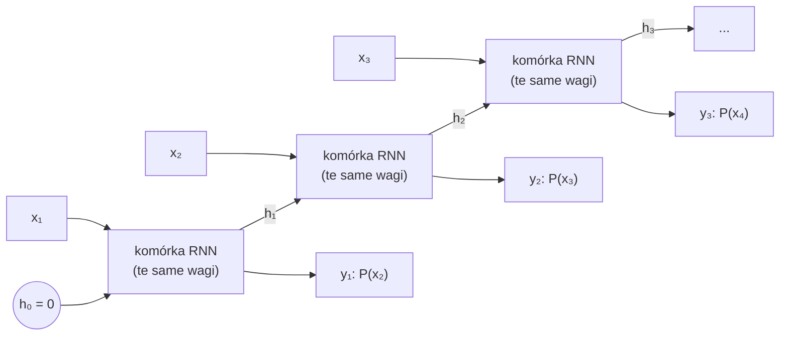
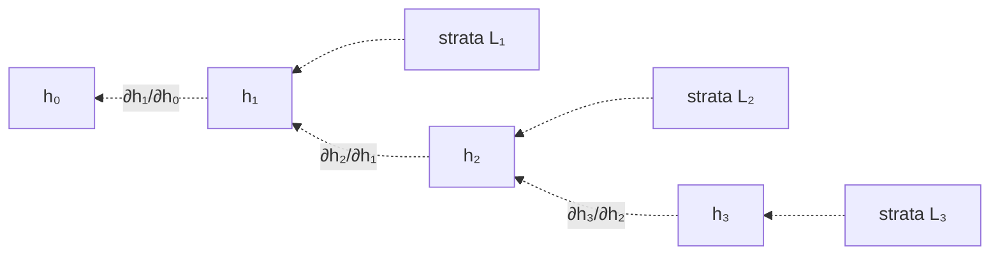
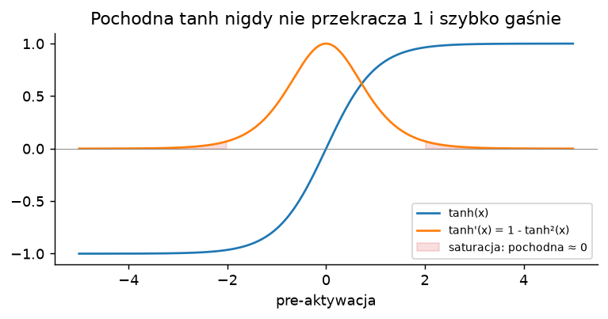
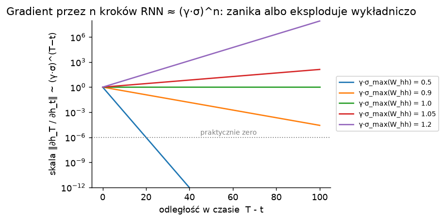
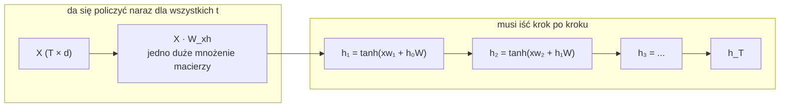

# 1. Sieci rekurencyjne (RNN): pamięć w jednym wektorze

> Notebook do tego rozdziału: [`01_rnn.ipynb`](01_rnn.ipynb)

## 1.1. Pomysł: ta sama funkcja w każdym kroku + stan

Zwykła sieć (MLP) przyjmuje wejście o stałym rozmiarze. Tekst ma dowolną długość, a znaczenie słowa zależy od
tego, co było wcześniej. Pomysł sieci rekurencyjnej ([Jordan, 1986](https://www.osti.gov/biblio/6910294);
[Elman, 1990 "Finding Structure in Time"](https://onlinelibrary.wiley.com/doi/10.1207/s15516709cog1402_1)):

- czytamy sekwencję **po jednym tokenie**,
- trzymamy **stan ukryty** $h_t$ (wektor długości $d$), który ma streszczać wszystko, co było do tej pory,
- w każdym kroku stosujemy **tę samą funkcję z tymi samymi wagami**:

$$
h_t = \tanh\left(W_{xh}\, x_t + W_{hh}\, h_{t-1} + b\right), \qquad y_t = W_{hy}\, h_t
$$

gdzie $x_t$ to embedding tokenu (rozdział 0), a $y_t$ to logity następnego tokenu.

To jest **rozwinięcie w czasie** (*unrolling*): jedna komórka narysowana T razy. W pamięci to jedna i ta sama
komórka. Liczba parametrów nie zależy od długości tekstu.

Dwie ważne własności:

- **Stały koszt kroku i stała pamięć**: żeby przetworzyć token $t$, potrzebujemy tylko $h_{t-1}$ i $x_t$.
  Nieważne, czy to 10. czy 10 000. token.
- **Cała historia musi się zmieścić w $h_t$**: $d$ liczb na streszczenie wszystkiego, co było.

## 1.2. Do czego używano (i używa się) RNN

RNN da się złożyć na kilka sposobów, zależnie od zadania (słynny obrazek z bloga
[Karpathy'ego "The Unreasonable Effectiveness of RNNs"](https://karpathy.github.io/2015/05/21/rnn-effectiveness/)):

| konfiguracja | przykład zastosowania |
|---|---|
| wiele → wiele (na bieżąco) | model języka, tagowanie części mowy, rozpoznawanie mowy klatka po klatce |
| wiele → jeden | klasyfikacja sentymentu recenzji, klasyfikacja szeregu czasowego |
| jeden → wiele | opisywanie obrazka (*image captioning*), generowanie muzyki |
| wiele → wiele (enkoder–dekoder) | tłumaczenie maszynowe ([seq2seq, 2014](https://arxiv.org/abs/1409.3215)) |

Historycznie RNN-y (głównie w wersji LSTM, rozdział 2) były przez lata state of the art w:

- **modelowaniu języka**: RNNLM Mikolova (2010) wyraźnie pobił modele n-gramowe w rozpoznawaniu mowy;
- **rozpoznawaniu mowy i pisma odręcznego** ([Graves, 2013](https://arxiv.org/abs/1308.0850));
- **tłumaczeniu maszynowym**: Google Translate przeszedł w 2016 na 8-warstwowy LSTM ([GNMT](https://arxiv.org/abs/1609.08144)).

Gdzie RNN-y mają sens dzisiaj? Wszędzie tam, gdzie dane przychodzą **strumieniowo**, a liczy się
**stała pamięć i stały czas na krok**: urządzenia brzegowe, przetwarzanie sygnałów i audio w czasie rzeczywistym,
szeregi czasowe, sterowanie i uczenie ze wzmocnieniem (polityki z pamięcią). I właśnie ta zaleta wraca
w RWKV i innych "nowoczesnych RNN-ach".

## 1.3. Jak się trenuje RNN: propagacja wsteczna w czasie (BPTT)

Po rozwinięciu w czasie RNN to po prostu **bardzo głęboka sieć** (T warstw), w której wszystkie warstwy
dzielą wagi. Trenujemy ją zwykłą propagacją wsteczną przez to rozwinięcie, co nazywa się
**BPTT** (*Backpropagation Through Time*, [Werbos, 1990](https://ieeexplore.ieee.org/document/58337)).

Gradient straty z pozycji $T$ dociera do wcześniejszych kroków tylko przez **iloczyn jakobianów**:

$$
\frac{\partial \mathcal{L}_T}{\partial h_t} = \frac{\partial \mathcal{L}_T}{\partial h_T}\prod_{j=t+1}^{T} \frac{\partial h_j}{\partial h_{j-1}},
\qquad
\frac{\partial h_j}{\partial h_{j-1}} = \operatorname{diag}\!\left(1 - h_j^2\right) W_{hh}
$$

W praktyce stosuje się **ucięte BPTT** (*truncated BPTT*): tniemy tekst na kawałki długości np. 128,
propagujemy gradient tylko w obrębie kawałka, a stan $h$ możemy przenosić dalej (bez gradientu).

## 1.4. Problem 1: znikający i eksplodujący gradient

W iloczynie powyżej ten sam czynnik $W_{hh}$ pojawia się $T-t$ razy. Pochodna tanh jest $\le 1$
(a w saturacji bliska 0):

Stąd szacowanie ([Pascanu, Mikolov, Bengio 2013](https://arxiv.org/abs/1211.5063)):

$$
\left\| \frac{\partial h_T}{\partial h_t} \right\| \;\le\; \left(\gamma \cdot \sigma_{\max}(W_{hh})\right)^{T-t},
\qquad \gamma = \max |\tanh'| \le 1
$$

- jeśli $\gamma\,\sigma_{\max} < 1$: gradient **znika wykładniczo**, więc sieć nie dowie się, że token sprzed
  50 kroków miał znaczenie;
- jeśli największa wartość własna $W_{hh}$ jest $> 1$: gradient może **eksplodować**, a trening wybucha (NaN).

To nie jest teoria z kosmosu. Problem opisał [Hochreiter (1991, praca dyplomowa)](https://people.idsia.ch/~juergen/SeppHochreiter1991ThesisAdvisorSchmidhuber.pdf)
i [Bengio, Simard, Frasconi (1994)](https://ieeexplore.ieee.org/document/279181): zwykły RNN w praktyce
nie uczy się zależności dłuższych niż kilkanaście–kilkadziesiąt kroków. W notebooku zmierzymy to wprost.

## 1.5. Problem 2: wszystko po kolei, czyli brak równoległości

Żeby policzyć $h_t$, trzeba znać $h_{t-1}$. Część obliczeń da się zrobić od razu dla wszystkich kroków:
$W_{xh} x_t$ zależy tylko od wejścia. Ale $W_{hh} h_{t-1}$ i $\tanh$ muszą iść **T razy po kolei**:

GPU ma tysiące rdzeni i jest szybkie, gdy dostaje **duże** macierze. RNN daje mu T **małych** mnożeń
(batch × d razy d × d) jedno po drugim. Przy długich sekwencjach to fundamentalne ograniczenie skali treningu.

## 1.6. Problem 3: wąskie gardło stanu

Cała przeszłość musi się zmieścić w $d$ liczbach. Jeśli model ma odpowiedzieć na pytanie o szczegół
z początku długiego tekstu, to musiał go "na zapas" zapamiętać w stanie, nie wiedząc, że pytanie padnie.
Do tego problemu wrócimy przy Transformerze (rozdział 3) i przy ograniczeniach RWKV (rozdział 4).

## 1.7. Jak łatano trening RNN (zanim przyszło LSTM i po nim)

| problem | łatka | źródło |
|---|---|---|
| eksplodujący gradient | **przycinanie gradientu** (*gradient clipping*): jeśli $\lVert g \rVert > \theta$, to $g \leftarrow \theta\, g / \lVert g \rVert$ | Mikolov (2012), [Pascanu i in. (2013)](https://arxiv.org/abs/1211.5063) |
| znikający gradient | **bramki**: LSTM, GRU (rozdział 2) | [Hochreiter i Schmidhuber (1997)](https://www.bioinf.jku.at/publications/older/2604.pdf) |
| zły start optymalizacji | inicjalizacja ortogonalna lub jednostkowa macierzy $W_{hh}$ (wartości własne ≈ 1) | [Saxe i in. (2013)](https://arxiv.org/abs/1312.6120), [Le i in. (2015), IRNN](https://arxiv.org/abs/1504.00941) |
| długie sekwencje | ucięte BPTT z przenoszeniem stanu | [Williams i Peng (1990)](https://doi.org/10.1162/neco.1990.2.4.490) |
| niestabilne aktywacje | normalizacja warstw (*LayerNorm*) | [Ba i in. (2016)](https://arxiv.org/abs/1607.06450) |

Przycinanie gradientu rozwiązuje tylko eksplozję. Na znikanie trzeba było zmienić samą architekturę.

## Podsumowanie

- RNN = ta sama komórka w każdym kroku + stan $h_t$. Stały koszt na token, stała pamięć.
- Trening przez BPTT: gradient płynie przez iloczyn T jakobianów, więc **zanika lub eksploduje wykładniczo**.
- Obliczenia są **sekwencyjne**: nie da się zrównoleglić po czasie, bo $h_t$ zależy nieliniowo od $h_{t-1}$.
- Cała historia musi się zmieścić w jednym wektorze.

W notebooku: implementujemy RNN od zera, sprawdzamy, że daje to samo co `torch.nn.RNN`, trenujemy go na
"Panu Tadeuszu", mierzymy zanik gradientu i sprawdzamy, na jak długą odległość RNN potrafi coś zapamiętać.

**Dalej:** [2. LSTM](02_lstm.md)
