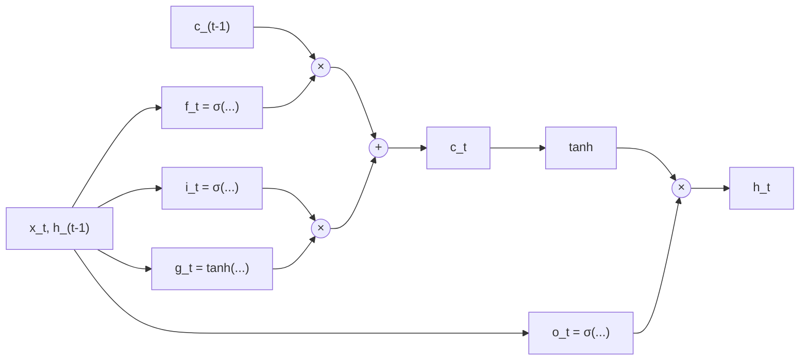
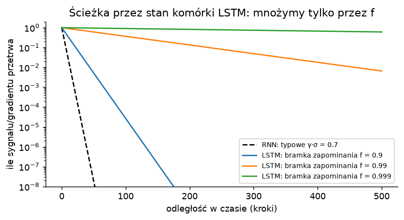

# 2. LSTM: bramki i "autostrada" dla gradientu

> Notebook do tego rozdziału: [`02_lstm.ipynb`](02_lstm.ipynb)

## 2.1. Skąd pomysł

Hochreiter w 1991 przeanalizował, dlaczego gradient w RNN znika (rozdział 1). Wniosek był prosty:
jeśli sygnał błędu ma przeżyć wiele kroków, to po drodze musi być mnożony przez coś **bliskiego 1**,
a nie przez $\tanh' \cdot W_{hh}$. W 1997 Hochreiter i Schmidhuber zaproponowali
[**Long Short-Term Memory**](https://www.bioinf.jku.at/publications/older/2604.pdf) z komórką pamięci,
w której błąd krąży z wagą 1: tzw. *Constant Error Carousel* (CEC).

Do tej "karuzeli" dostęp regulują **bramki**: małe sieci z sigmoidą na wyjściu (wartości 0–1),
które decydują, ile informacji wpuścić, ile zapomnieć i ile wypuścić.

## 2.2. Równania (współczesna wersja, z bramką zapominania)

$$
\begin{aligned}
f_t &= \sigma(W_f x_t + U_f h_{t-1} + b_f) &&\text{bramka zapominania: ile starej pamięci zostawić}\\
i_t &= \sigma(W_i x_t + U_i h_{t-1} + b_i) &&\text{bramka wejścia: ile nowej informacji zapisać}\\
g_t &= \tanh(W_g x_t + U_g h_{t-1} + b_g) &&\text{kandydat: co ewentualnie zapisać}\\
o_t &= \sigma(W_o x_t + U_o h_{t-1} + b_o) &&\text{bramka wyjścia: ile pamięci pokazać na zewnątrz}\\
c_t &= f_t \odot c_{t-1} + i_t \odot g_t &&\text{stan komórki (pamięć długa)}\\
h_t &= o_t \odot \tanh(c_t) &&\text{stan ukryty (to, co widzą inne warstwy)}
\end{aligned}
$$

$\odot$ to mnożenie element po elemencie. W praktyce wszystkie cztery "bramki" liczy się jednym mnożeniem
macierzy $[W\,|\,U] \cdot [x_t; h_{t-1}]$ o wyjściu $4d$, które potem tnie się na cztery części.

Górna pozioma linia ($c_{t-1} \to \times \to + \to c_t$) to **taśmociąg pamięci**: informacja płynie nią
prawie bez zmian, a bramki tylko decydują, co z niej skasować ($f_t$) i co dopisać ($i_t \odot g_t$).
Świetna ilustrowana wersja: [Chris Olah, "Understanding LSTM Networks"](https://colah.github.io/posts/2015-08-Understanding-LSTMs/).

## 2.3. Dlaczego gradient przestaje znikać

Popatrzmy na bezpośrednią ścieżkę przez stan komórki:

$$
\frac{\partial c_t}{\partial c_{t-1}} = \operatorname{diag}(f_t) \quad (+\ \text{składniki pośrednie przez } h_{t-1})
$$

Porównaj z RNN: $\partial h_t / \partial h_{t-1} = \operatorname{diag}(1-h_t^2)\,W_{hh}$.

- W RNN w każdym kroku mnożymy przez **macierz wag i pochodną tanh**. To prawie zawsze kurczy (albo rozdyma) sygnał.
- W LSTM na ścieżce przez $c$ mnożymy tylko przez **wartości bramki zapominania**. Jeśli sieć nauczy się
  $f_t \approx 1$ dla jakiegoś kanału, to ten kanał przenosi informację (i gradient) przez setki kroków.
- Aktualizacja jest **addytywna**: $c_t = f_t c_{t-1} + (\text{nowe})$, zamiast "przepuść wszystko przez nieliniowość".

Ta sama idea, czyli "dodawaj do strumienia, zamiast go przekształcać", wróciła potem w głębokich sieciach jako
[Highway Networks (2015)](https://arxiv.org/abs/1505.00387) i [ResNet (2015)](https://arxiv.org/abs/1512.03385).
Połączenia rezydualne w Transformerze i RWKV to ten sam trik, tylko w głąb sieci zamiast w czasie.

## 2.4. Krótka historia (warto wiedzieć, kto co dodał)

- **1997**: oryginalne LSTM **nie miało bramki zapominania**. Komórka mogła tylko rosnąć, a CEC miał wagę dokładnie 1.
- **2000**: [Gers, Schmidhuber, Cummins, "Learning to Forget"](https://doi.org/10.1162/089976600300015015)
  dodają bramkę zapominania. To wersja, której wszyscy dziś używają.
- **2000**: połączenia *peephole* (bramki widzą też $c_{t-1}$).
- **2014**: [GRU (Cho i in.)](https://arxiv.org/abs/1406.1078), uproszczenie z dwiema bramkami
  (*update*, *reset*), bez osobnego $c_t$. Działa porównywalnie.
- **2015–2017**: wielkie porównania ([Jozefowicz i in. 2015](https://proceedings.mlr.press/v37/jozefowicz15.html),
  [Greff i in. "LSTM: A Search Space Odyssey"](https://arxiv.org/abs/1503.04069)) pokazują, że najważniejsze są
  bramka zapominania i jej inicjalizacja.

## 2.5. Jak wygląda trening LSTM w praktyce

Mechanicznie to dalej BPTT: rozwijamy w czasie i liczymy gradienty. Różnica polega na tym, że gradient ma
teraz "autostradę" przez $c_t$. Zestaw sprawdzonych trików z lat 2014–2018:

| trik | po co | źródło |
|---|---|---|
| **bias bramki zapominania = 1** na starcie | sieć zaczyna od "pamiętaj wszystko" ($\sigma(1)\approx 0{,}73$) zamiast od "zapomnij połowę"; dużo szybsza nauka długich zależności | Gers i in. (2000), [Jozefowicz i in. (2015)](https://proceedings.mlr.press/v37/jozefowicz15.html) |
| **przycinanie gradientu** | LSTM nadal potrafi wybuchnąć | [Pascanu i in. (2013)](https://arxiv.org/abs/1211.5063) |
| inicjalizacja ortogonalna $U$ | stabilny start dynamiki rekurencyjnej | [Saxe i in. (2013)](https://arxiv.org/abs/1312.6120) |
| dropout tylko między warstwami (nie na ścieżce rekurencyjnej) | regularizacja bez niszczenia pamięci | [Zaremba i in. (2014)](https://arxiv.org/abs/1409.2329) |
| dropout wariacyjny / *weight drop* | regularizacja także połączeń rekurencyjnych | [Gal i Ghahramani (2016)](https://arxiv.org/abs/1512.05287), [AWD-LSTM (2017)](https://arxiv.org/abs/1708.02182) |
| LayerNorm wewnątrz komórki | stabilniejsze i szybsze uczenie | [Ba i in. (2016)](https://arxiv.org/abs/1607.06450) |
| ucięte BPTT + przenoszenie stanu między batchami | długie teksty przy ograniczonej pamięci | standard |

Koszt: LSTM ma **4× więcej parametrów** na jednostkę ukrytą niż zwykły RNN (cztery zestawy wag zamiast jednego).

## 2.6. Gdzie LSTM pomógł (lata ~2013–2018)

LSTM był domyślnym wyborem do sekwencji przez kilka lat:

- rozpoznawanie mowy ([Graves i in. 2013](https://arxiv.org/abs/1303.5778)), od 2015 w wyszukiwaniu głosowym Google;
- tłumaczenie maszynowe: [seq2seq (Sutskever i in. 2014)](https://arxiv.org/abs/1409.3215) i
  [Google Neural Machine Translation (2016)](https://arxiv.org/abs/1609.08144);
- modelowanie języka: [AWD-LSTM (2017)](https://arxiv.org/abs/1708.02182), [ELMo (2018)](https://arxiv.org/abs/1802.05365);
- opisywanie obrazków, generowanie pisma odręcznego, muzyki;
- RL: OpenAI Five (Dota 2) i AlphaStar (StarCraft II) miały rdzeń LSTM.

## 2.7. Czego LSTM nie naprawia

1. **Dalej jest sekwencyjny.** $h_t$ zależy od $h_{t-1}$ przez mnożenie macierzy i nieliniowość, więc trening
   nie zrównolegli się po czasie. Przy długich sekwencjach to boli tak samo jak w RNN.
2. **Dalej ma stan o stałym rozmiarze.** Bramki pozwalają lepiej wybierać, co trzymać, ale pojemność jest stała.
3. **W praktyce efektywny kontekst jest krótki.** [Khandelwal i in. (2018), "Sharp Nearby, Fuzzy Far Away"](https://arxiv.org/abs/1805.04623)
   pokazali, że modele języka na LSTM korzystają z ok. 200 tokenów kontekstu, a kolejność słów ma dla nich
   znaczenie tylko w ostatnich ~50.

Szczególnie bolało to w tłumaczeniu: enkoder LSTM musiał ścisnąć **całe zdanie** do jednego wektora,
a dekoder generował z tego tłumaczenie. Rozwiązaniem okazała się **uwaga** (*attention*,
[Bahdanau i in. 2014](https://arxiv.org/abs/1409.0473)): dekoder w każdym kroku "patrzy" na wszystkie
stany enkodera. Stąd był już krok do pomysłu "a gdyby wyrzucić rekurencję całkiem?" (rozdział 3).

## Podsumowanie

- LSTM dodaje stan komórki $c_t$ z **addytywną** aktualizacją i bramki $f, i, o$ (sigmoidy 0–1).
- Gradient płynie przez $c_t$ mnożony tylko przez $f_t$, więc przy $f_t \approx 1$ nie znika.
- Kluczowe triki treningowe: bias bramki zapominania = 1, przycinanie gradientu, dropout między warstwami.
- Nie znika problem sekwencyjności ani stałej pojemności stanu.

W notebooku: LSTM od zera, porównanie z `torch.nn.LSTM`, trening, porównanie przepływu gradientu z RNN
(w tym efekt biasu bramki zapominania) i zadanie pamięciowe na różnych odległościach.

**Dalej:** [3. Transformer](03_transformer.md)
