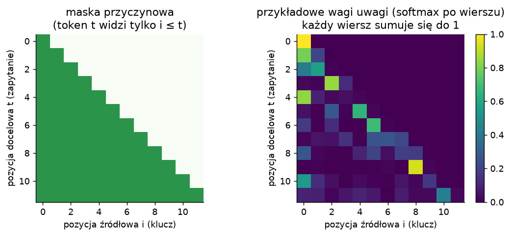
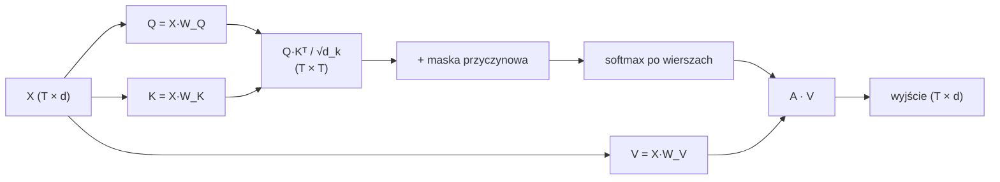
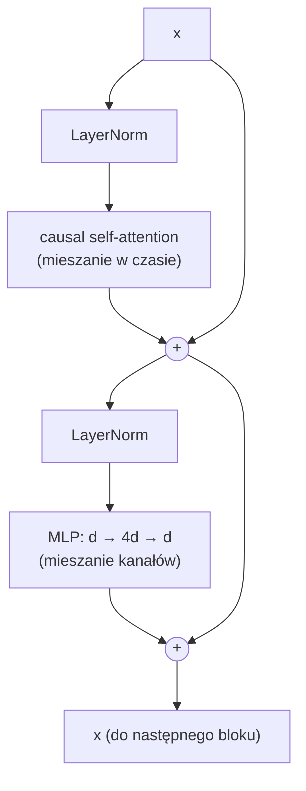
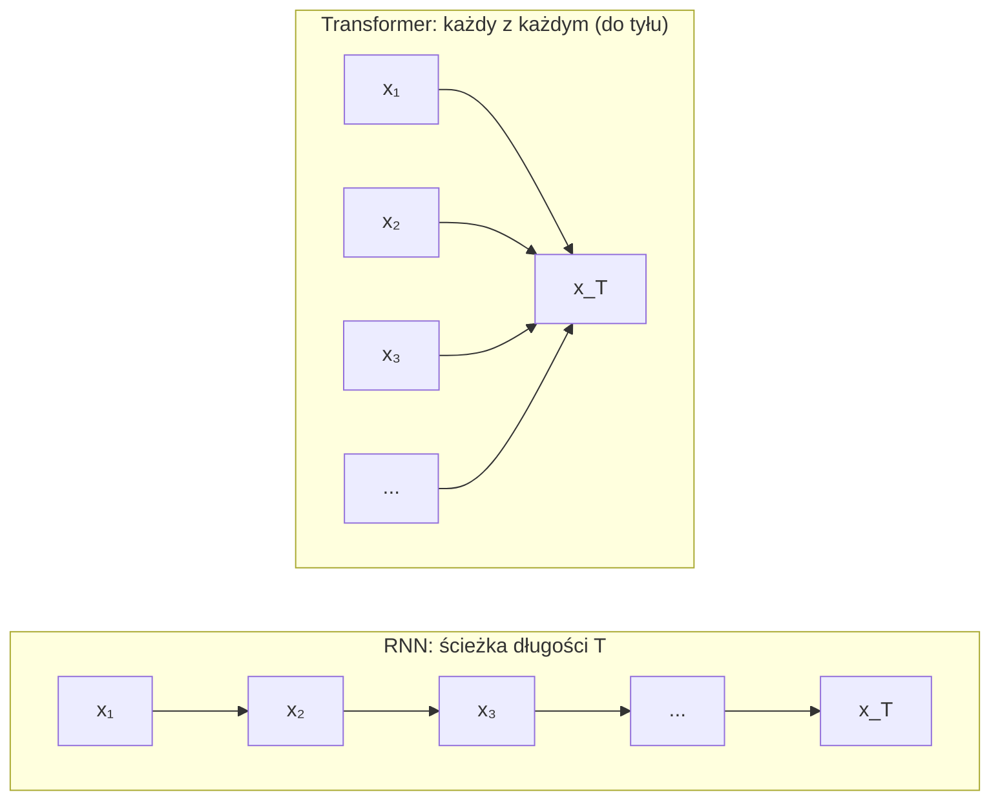
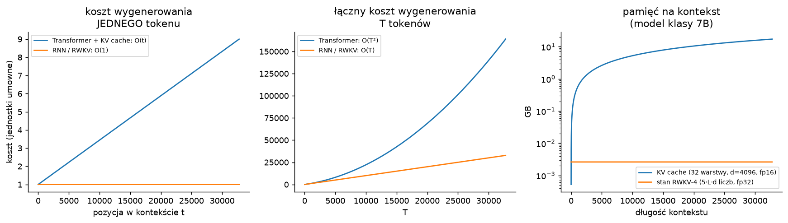

# 3. Transformer: wyrzućmy rekurencję

> Notebook do tego rozdziału: [`03_transformer.ipynb`](03_transformer.ipynb)

## 3.1. Skąd się wziął: uwaga w tłumaczeniu

W enkoderze–dekoderze na LSTM całe zdanie trzeba było ścisnąć do jednego wektora (rozdział 2).
[Bahdanau, Cho, Bengio (2014)](https://arxiv.org/abs/1409.0473) dodali **uwagę** (*attention*): dekoder
w każdym kroku liczy wagi dla **wszystkich** stanów enkodera i bierze ich średnią ważoną. Model sam uczy się,
na które słowo zdania źródłowego patrzeć. Wyniki dla długich zdań skoczyły w górę.

W 2017 [Vaswani i in., "Attention Is All You Need"](https://arxiv.org/abs/1706.03762) poszli o krok dalej:
**uwaga zamiast rekurencji**, także wewnątrz enkodera i dekodera (*self-attention*). Każdy token patrzy
bezpośrednio na każdy inny (w modelu języka: na każdy wcześniejszy).

## 3.2. Self-attention krok po kroku

Każdy token (wektor $x_t$) dostaje trzy "role", liczone trzema macierzami wag:

- **zapytanie** $q_t = W_Q x_t$: czego szukam?
- **klucz** $k_i = W_K x_i$: co oferuję innym?
- **wartość** $v_i = W_V x_i$: co przekażę, jeśli ktoś na mnie spojrzy?

Wyjście dla tokenu $t$ to średnia ważona wartości wcześniejszych tokenów. Wagi mówią, jak bardzo zapytanie $t$
pasuje do klucza $i$:

$$
\text{out}_t = \sum_{i \le t} \alpha_{t,i}\, v_i, \qquad
\alpha_{t,i} = \frac{\exp\left(q_t \cdot k_i / \sqrt{d_k}\right)}{\sum_{j\le t} \exp\left(q_t \cdot k_j / \sqrt{d_k}\right)}
$$

Macierzowo, dla całej sekwencji naraz:

$$
\text{Attention}(Q, K, V) = \operatorname{softmax}\!\left(\frac{QK^\top}{\sqrt{d_k}} + M\right) V,
\qquad M_{t,i} = \begin{cases} 0 & i \le t \\ -\infty & i > t \end{cases}
$$

$M$ to **maska przyczynowa**: zabrania patrzenia w przyszłość. $\sqrt{d_k}$ pilnuje, żeby iloczyny skalarne
nie rosły z wymiarem (inaczej softmax by się nasycał).

**Wiele głów** (*multi-head*): zamiast jednej uwagi o wymiarze $d$ robimy $h$ niezależnych uwag o wymiarze
$d/h$ i sklejamy wyniki. Każda głowa może specjalizować się w czymś innym: poprzedni token, początek zdania,
pasujący nawias i tak dalej.

**Intuicja**: to "miękki słownik". Zapytanie porównujemy ze wszystkimi kluczami i zamiast jednej wartości
zwracamy średnią ważoną podobieństwem.

## 3.3. Skąd model wie, gdzie jest token?

Attention samo w sobie nie widzi kolejności: zbiór par $(k_i, v_i)$ można przetasować, a wynik się nie zmieni.
Dlatego dodaje się **informację o pozycji**:

- sinusoidalne kodowanie pozycji (oryginalny Transformer),
- uczony embedding pozycji (GPT-2, nasz notebook),
- RoPE: obrót wektorów q i k zależny od pozycji (LLaMA i wiele innych),
- **ALiBi** ([Press i in. 2021](https://arxiv.org/abs/2108.12409)): kara za odległość wprost w wyniku uwagi,
  $q_t \cdot k_i - m\,(t - i)$. **Zapamiętaj ten pomysł**: RWKV robi coś bardzo podobnego, tylko z uczonym $m$
  dla każdego kanału (rozdział 4).

## 3.4. Blok Transformera

- **Połączenia rezydualne** ($x + f(x)$): gradient ma prostą drogę przez wszystkie warstwy, tak jak w LSTM w czasie.
- **LayerNorm przed** podwarstwą (*Pre-LN*): stabilniejszy trening głębokich modeli
  ([Xiong i in. 2020](https://arxiv.org/abs/2002.04745)). Oryginalny Transformer miał *Post-LN* i wymagał
  starannej rozgrzewki (*warmup*) learning rate.
- **MLP** (*feed-forward*) działa na każdej pozycji osobno. To tu "siedzi" większość parametrów i wiedzy modelu.

GPT = embedding + pozycje + N takich bloków + LayerNorm + warstwa wyjściowa.

## 3.5. Dlaczego to działa tak dobrze

### (a) Trening równoległy po czasie

Wszystkie operacje w bloku (projekcje Q/K/V, $QK^\top$, softmax, MLP) to **duże mnożenia macierzy na całej
sekwencji naraz**. Z jednego okna długości T dostajemy T przykładów treningowych (przewidź token 2, 3, ..., T+1)
w jednym przebiegu, bez pętli po czasie. GPU pracują wtedy blisko swojej maksymalnej wydajności, a to pozwoliło
skalować modele do miliardów parametrów i bilionów tokenów ([prawa skalowania, Kaplan i in. 2020](https://arxiv.org/abs/2001.08361)).

### (b) Krótka droga między dowolnymi tokenami

| warstwa | koszt na warstwę | operacje sekwencyjne | max. długość ścieżki między tokenami |
|---|---|---|---|
| self-attention | $O(T^2 \cdot d)$ | $O(1)$ | $O(1)$ |
| rekurencyjna (RNN/LSTM) | $O(T \cdot d^2)$ | $O(T)$ | $O(T)$ |
| konwolucyjna (jądro $k$) | $O(k \cdot T \cdot d^2)$ | $O(1)$ | $O(\log_k T)$ |

*(Tabela 1 z "Attention Is All You Need".)*

W RNN informacja z tokenu 1 do tokenu 1000 musi przejść przez 999 kroków rekurencji, za każdym razem
"przemielona" przez nieliniowość. W Transformerze token 1000 patrzy na token 1 **bezpośrednio**, w jednym
kroku. Gradient też ma tę krótką drogę, więc nie ma zanikania po czasie.

### (c) Dynamiczne, zależne od treści wagi

Wagi $\alpha_{t,i}$ zależą od **zawartości** obu tokenów ($q_t \cdot k_i$), więc model może zrobić precyzyjne
"wyszukiwanie": znaleźć wcześniejsze wystąpienie imienia i skopiować, co było dalej. Tak działają
*induction heads* ([Olsson i in. 2022](https://transformer-circuits.pub/2022/in-context-learning-and-induction-heads/index.html)),
mechanizm uważany za podstawę uczenia w kontekście (*in-context learning*).

### (d) Brak wąskiego gardła: pamięć rośnie z kontekstem

"Stanem" Transformera są wszystkie dotychczasowe klucze i wartości. Nic nie jest kompresowane, więc
każdy szczegół z kontekstu jest dostępny bez strat.

### (e) Sprawdzony przepis na stabilny trening

Rezydua + LayerNorm (Pre-LN), skalowanie $1/\sqrt{d_k}$, Adam z rozgrzewką learning rate,
mała inicjalizacja projekcji wyjściowych, przycinanie gradientu.

## 3.6. Cena: kwadrat długości

- **Trening**: macierz uwagi ma rozmiar $T \times T$, więc czas i pamięć rosną jak $O(T^2)$.
  Dlatego modele mają ograniczony kontekst, a FlashAttention optymalizuje pamięć (ale nie złożoność czasową).
- **Generowanie**: każdy nowy token musi spojrzeć na **wszystkie** poprzednie. Żeby nie liczyć wszystkiego od
  nowa, trzyma się **KV cache** (zapamiętane klucze i wartości wszystkich tokenów). Ale:
  - koszt jednego tokenu rośnie liniowo z długością kontekstu: $O(t \cdot d)$ na warstwę,
  - wygenerowanie $T$ tokenów kosztuje $O(T^2)$,
  - **pamięć KV cache rośnie liniowo**: model klasy 7B (32 warstwy, $d=4096$, fp16) zajmuje ok.
    **0,5 MB na każdy token kontekstu**, czyli ok. 16 GB przy 32 tys. tokenów.

## 3.7. Czego RNN-y nigdy nie dostaną (przez swoją architekturę)

1. **Równoległego treningu przy nieliniowej rekurencji.** Jeśli $h_t = f(h_{t-1}, x_t)$ i $f$ jest nieliniowe
   (tanh, bramki zależne od $h_{t-1}$), to trzeba policzyć $T$ zależnych kroków jeden po drugim. Żadna sztuczka
   tego nie obejdzie.
   **Ale uwaga, tu jest furtka:** jeśli rekurencja jest **liniowa** względem stanu (np. $s_t = \lambda \odot s_{t-1} + z_t$),
   to da się ją policzyć równolegle (*parallel scan*), a nawet zapisać jak attention. Przez tę furtkę wchodzi RWKV.
2. **Bezstratnego dostępu do dowolnego miejsca w przeszłości.** Stan o stałym rozmiarze to **stratna kompresja**
   historii. Nie zmieścisz dowolnie długiego tekstu w $d$ liczbach. Modele ze stałym stanem nie potrafią więc np.
   wiernie skopiować długiego ciągu z kontekstu ani odnaleźć dowolnej pary klucz–wartość sprzed tysięcy tokenów.
   Pokazano to teoretycznie i eksperymentalnie:
   [Jelassi i in. 2024, "Repeat After Me"](https://arxiv.org/abs/2402.01032),
   [Arora i in. 2023, "Zoology"](https://arxiv.org/abs/2312.04927).
   Transformer nie ma tego problemu, bo jego "stan" (KV cache) rośnie z kontekstem.
3. **Możliwości "przeczytania jeszcze raz" w świetle pytania.** RNN czyta tekst raz, od lewej do prawej, i musi
   z góry zgadywać, co warto zapamiętać. Jeśli pytanie pada **po** tekście, może być za późno. Autorzy RWKV
   sami to zmierzyli: samo przestawienie kolejności w prompcie (pytanie przed tekstem) podniosło wynik F1
   RWKV na zadaniu RTE z 44,2% do 74,8% ([paper RWKV, Appendix L](https://arxiv.org/abs/2305.13048)).

Punkt 1 jest do obejścia (RWKV to pokazuje), punkty 2–3 to fundamentalny kompromis:
**stała pamięć ⇔ stratna pamięć**.

## 3.8. Pytanie, które prowadzi do RWKV

> Czy da się mieć **trening równoległy jak w Transformerze** i jednocześnie **stały koszt generowania jak w RNN**?

Pierwsze próby:

- **Linear attention** ([Katharopoulos i in. 2020, "Transformers are RNNs"](https://arxiv.org/abs/2006.16236)):
  zamieńmy $\exp(q \cdot k)$ na $\phi(q)\cdot\phi(k)$. Wtedy z łączności mnożenia
  $\sum_i \phi(q_t)^\top \phi(k_i) v_i = \phi(q_t)^\top \underbrace{\textstyle\sum_i \phi(k_i) v_i^\top}_{S_t}$,
  a $S_t = S_{t-1} + \phi(k_t) v_t^\top$ to **rekurencja**. Transformer staje się RNN-em z macierzowym stanem.
- **AFT, Attention Free Transformer** ([Zhai i in. 2021, Apple](https://arxiv.org/abs/2105.14103)): zamiast
  iloczynu $q\cdot k$ uwaga działa **osobno w każdym kanale**, z uczonymi wagami pozycyjnymi $w_{t,i}$.
  To bezpośredni przodek RWKV.

## Podsumowanie

- Self-attention: każdy token bierze średnią ważoną wartości wcześniejszych tokenów, z wagami
  $\operatorname{softmax}(q \cdot k)$.
- Zalety: **trening równoległy**, **ścieżka O(1)** między tokenami, wagi zależne od treści, brak kompresji kontekstu.
- Wady: $O(T^2)$ w treningu, **koszt tokenu i pamięć KV cache rosną z kontekstem** podczas generowania.
- RNN nigdy nie dostanie równoległego treningu przy **nieliniowej** rekurencji ani bezstratnej pamięci przy
  stałym stanie. To pierwsze da się obejść liniową rekurencją, drugie nie.

W notebooku: attention od zera, mini-GPT, wizualizacja wag uwagi, KV cache i pomiar, jak rośnie koszt
jednego tokenu z długością kontekstu (do porównania z RWKV w rozdziale 4).

**Dalej:** [4. RWKV](04_rwkv.md)
