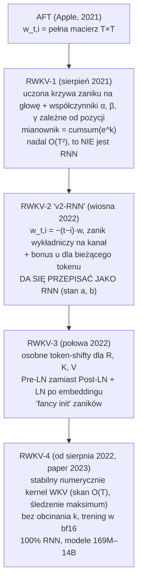
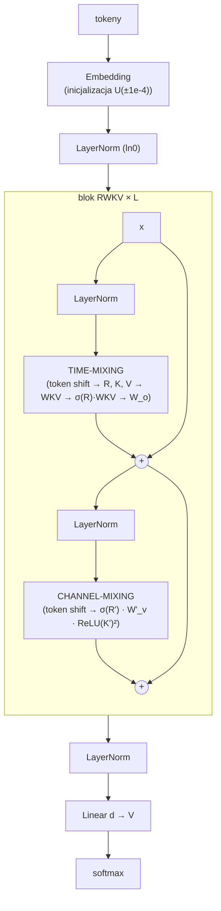
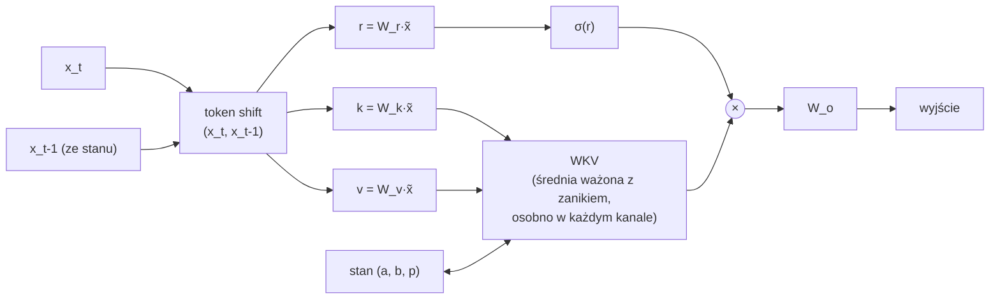
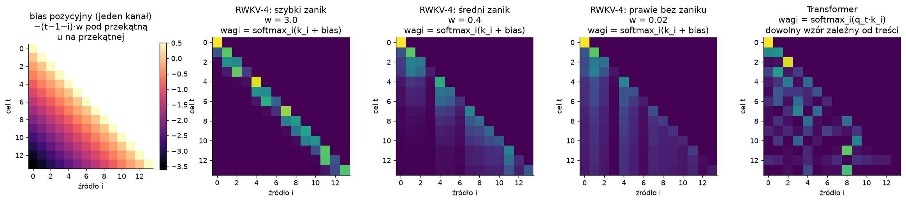
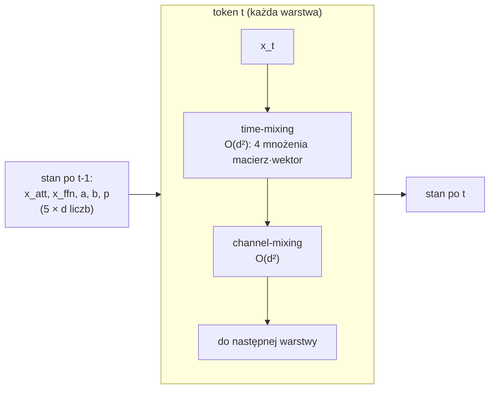
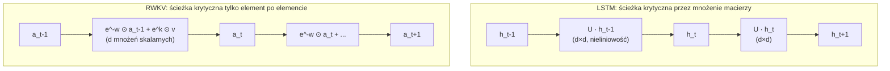
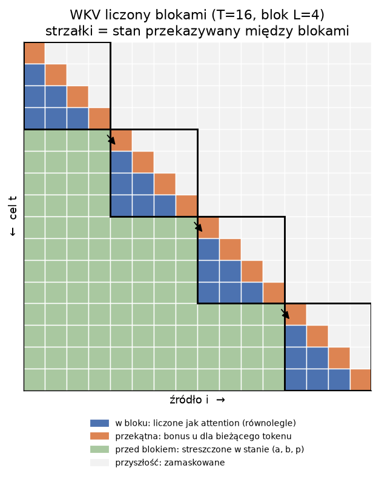
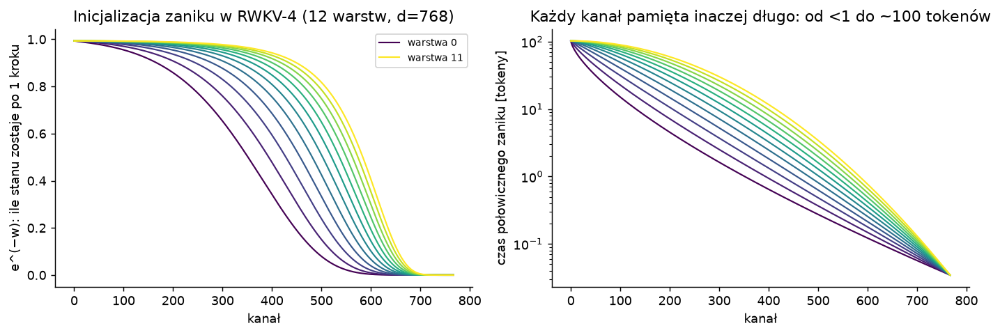

# 4. RWKV: RNN, który trenuje się jak Transformer

> Notebook do tego rozdziału: [`04_rwkv.ipynb`](04_rwkv.ipynb). Implementujemy tam RWKV-4 od zera w PyTorch.
>
> Zakres: **pierwsze wersje projektu (RWKV-1 → RWKV-4)**, czyli to, co opisuje paper
> [*RWKV: Reinventing RNNs for the Transformer Era* (Peng i in., 2023)](https://arxiv.org/abs/2305.13048).
> Późniejsze wersje (5 "Eagle", 6 "Finch", 7 "Goose") celowo pomijamy.

**W skrócie**: RWKV to sieć, która ma dwa równoważne sposoby liczenia. W treningu liczy się jak Transformer,
czyli wszystkie tokeny naraz, dużymi mnożeniami macierzy. W generowaniu działa jak RNN: stały koszt na token
i stała pamięć, bez KV cache. Trik polega na tym, że jedyna część zależna od przeszłości to **liniowa,
element-po-elemencie rekurencja ze stałym (niezależnym od danych) zanikiem**. Taką rekurencję można policzyć
na trzy sposoby: krok po kroku, wszystko naraz jak attention, albo blokami.

---

## 4.1. Kto, co, kiedy

- **RWKV** = *Receptance Weighted Key Value*, czytane "RwaKuv" (od czterech głównych parametrów R, W, K, V).
- Autor pomysłu i większości kodu: **Bo Peng** ([BlinkDL](https://github.com/BlinkDL/RWKV-LM)), niezależny badacz.
  Projekt rozwijany przez społeczność na Discordzie RWKV i EleutherAI, moc obliczeniową dało Stability AI.
  Prowadzący nie bez powodu nazwał to "prawie crowdsourcingową nauką".
- Paper: maj 2023, opublikowany w [Findings of EMNLP 2023](https://aclanthology.org/2023.findings-emnlp.936/).
  Modele od 169M do **14B parametrów**: "zdecydowanie największy gęsty RNN, jaki kiedykolwiek wytrenowano"
  (w chwili publikacji), z wynikami na poziomie Transformerów tej samej wielkości.
- Dziś RWKV jest [projektem Linux Foundation AI](https://lfaidata.foundation/projects/rwkv/).
- **Polski akcent**: wśród współautorów są Przemysław Kazienko, Jan Kocoń, Bartłomiej Koptyra i Stanisław Woźniak
  z **Politechniki Wrocławskiej**. Zrobili m.in. eksperymenty z promptami i porównania z ChatGPT (Appendix L).

## 4.2. Przodkowie: z czego RWKV jest złożone

| pomysł | co daje | źródło |
|---|---|---|
| **linear attention** | attention bez softmaxa da się zapisać jako rekurencję ze stanem | [Katharopoulos i in. 2020](https://arxiv.org/abs/2006.16236) |
| **AFT** (Attention Free Transformer) | "uwaga" osobno dla każdego kanału, bez iloczynu $q\cdot k$, z uczonymi biasami pozycji $w_{t,i}$ | [Zhai i in. 2021](https://arxiv.org/abs/2105.14103) |
| **QRNN / SRU** | ciężkie obliczenia (macierze) równolegle, lekka rekurencja element po elemencie | [Bradbury i in. 2016](https://arxiv.org/abs/1611.01576), [Lei i in. 2017](https://arxiv.org/abs/1709.02755) |
| **time-weighting** (BlinkDL, 2020) | skalowanie uwagi przez odległość w czasie | [minGPT-tuned](https://github.com/BlinkDL/minGPT-tuned) |
| **token shift** (BlinkDL) | mieszanie bieżącego tokenu z poprzednim, jak mini-konwolucja | [README RWKV-LM](https://github.com/BlinkDL/RWKV-LM#token-shift-time-shift-mixing) |
| **SmallInitEmb** (BlinkDL) | malutka inicjalizacja embeddingów + LayerNorm, czyli szybszy, stabilny start | [SmallInitEmb](https://github.com/BlinkDL/SmallInitEmb) |
| **squared ReLU** | $\max(x,0)^2$ w MLP | [Primer, So i in. 2021](https://arxiv.org/abs/2109.08668) |

Najważniejszy jest **AFT**. Dla tokenu $t$ liczy (w każdym kanale osobno):

$$
\text{AFT}_t = \sigma(q_t) \odot \frac{\sum_{i \le t} \exp(k_i + w_{t,i}) \odot v_i}{\sum_{i\le t} \exp(k_i + w_{t,i})}
$$

To średnia ważona wartości, z wagami zależnymi od klucza $k_i$ i od **uczonego biasu pozycyjnego** $w_{t,i}$.
W AFT $w_{t,i}$ to pełna macierz $T \times T$, więc nie da się tego zapisać jako RNN.
**Cały pomysł RWKV to ograniczenie $w_{t,i}$ do postaci, która daje rekurencję.**

## 4.3. Ewolucja: RWKV-1 → RWKV-4

Poniższe opisy pochodzą z [oryginalnego kodu każdej wersji](https://github.com/BlinkDL/RWKV-LM)
(katalogi `RWKV-v1`, `RWKV-v2-RNN`, `RWKV-v3`, `RWKV-v4`) i z README autora.

### RWKV-1 (sierpień 2021): AFT z dodatkami

- Bloki naprzemiennie: **time-mix** (wariant AFT) i **channel-mix** (wariant GeGLU z bramką R).
- Wagi czasowe: dla każdej głowy uczona **krzywa w zależności od odległości** (macierz Toeplitza $T\times T$),
  inicjalizowana jako zanik wykładniczy o różnej szybkości w różnych głowach, plus współczynniki $\alpha, \beta, \gamma$
  zależne od **bezwzględnej pozycji** (żeby skompensować krótki kontekst na początku sekwencji).
- Mianownik: zwykła suma kumulatywna $\sum_{i\le t} e^{k_i}$ (bez zaniku).
- Token shift: połowa kanałów brana z poprzedniego tokenu.
- Zerowa inicjalizacja macierzy K, R i projekcji wyjściowej. Head-QK: dodatkowy mechanizm kopiowania tokenów na wyjściu.
- **To jeszcze nie RNN**: wagi zależą od pozycji bezwzględnej i od długości kontekstu.

### RWKV-2 "v2-RNN" (wiosna 2022): narodziny RNN

Kluczowa zmiana, "punchline" całego projektu:

$$
w_{t,i} = -(t-1-i)\, w \qquad (w > 0,\ \text{osobne dla każdego kanału})
$$

czyli waga tokenu sprzed $n$ kroków to $e^{-n w}$: **zanik wykładniczy**, taki sam w każdym miejscu sekwencji.
Bieżący token dostaje osobną wagę $e^{u}$ (*time_first*, "bonus"). Do tego wrócił mianownik w stylu AFT.

Skoro każdy krok mnoży starą sumę przez $e^{-w}$, to sumy da się aktualizować rekurencyjnie (sekcja 4.6).
W README: *"RWKV v2 is a RNN with transformer-level LM performance"*. Model 27M na enwik8: 0,72 bita/znak.
Sepp Hochreiter (twórca LSTM) [zauważył to na Twitterze](https://twitter.com/HochreiterSepp/status/1524270961314484227) w maju 2022.

Szczegóły v2: zanik parametryzowany jako $w = e^{\text{time\_decay}}$ (zawsze dodatni), squared ReLU w FFN,
Post-LN z SmallInitEmb. Tryb GPT liczony własnym kernelem CUDA jako **splot przyczynowy** z krzywą zaniku.
Problemy numeryczne łatane brutalnie: `k = clamp(k, max=60)` (żeby $e^k$ się mieściło) i `+1e-16` w mianowniku.

### RWKV-3 (połowa 2022): lepszy token shift i Pre-LN

- **Osobne, uczone współczynniki token shift dla R, K i V** (w v2 był jeden wspólny).
- **Pre-LN zamiast Post-LN** (*"more stable & faster convergence"*) i dodatkowy LayerNorm zaraz po embeddingu (`ln0`).
- Nowa, "fancy" inicjalizacja zaników, bonusu i token shiftu (ta sama, której używa RWKV-4, sekcja 4.10).
- Wytrenowany model 1,5B na *the Pile*.

### RWKV-4 (od sierpnia 2022; paper w 2023): wersja "na serio"

- **Nowy kernel WKV**: zamiast splotu $O(T^2)$ na kanał jest **skan liniowy $O(T)$**, a przede wszystkim
  **stabilny numerycznie** dzięki śledzeniu wspólnego wykładnika (sekcja 4.9). Bez obcinania $k$ i bez epsilonów.
  Działa przy treningu w bf16/fp16, bo stan liczony jest w fp32. Autorem optymalizacji CUDA jest m.in. Johan S. Wind.
- **Usunięty Head-QK**, więc model jest w 100% RNN-em (Head-QK wymagał trzymania wszystkich poprzednich kluczy).
- Pomocnicza strata w stylu PaLM (`L2Wrap`), która trzyma logity blisko zera.
- Modele RWKV-4 Pile (169M–14B, 330 mld tokenów), potem RWKV-4 Raven (czat) i World (wielojęzyczne).

## 4.4. Architektura RWKV-4

Porównaj z blokiem Transformera (rozdział 3.4): **szkielet jest identyczny** (Pre-LN, rezydua, mieszanie w czasie
+ mieszanie kanałów). Różni się tylko to, co jest w środku obu podbloków.

### Token shift: mini-konwolucja o rozmiarze 2

Każde wejście do projekcji to mieszanka bieżącego i **poprzedniego** tokenu, z uczonymi wagami dla każdego kanału:

$$
\tilde{x}_t^{(r)} = \mu_r \odot x_t + (1-\mu_r)\odot x_{t-1}
$$

(osobne $\mu_r, \mu_k, \mu_v$ w time-mixingu i $\mu'_r, \mu'_k$ w channel-mixingu). W PyTorch to po prostu
przesunięcie tensora o jedną pozycję w czasie: `nn.ZeroPad2d((0, 0, 1, -1))`. Dzięki temu nawet bez WKV każdy
token "widzi" swojego poprzednika. BlinkDL tłumaczy to tak: część kanałów może się skupić na przekazywaniu
kontekstu dalej, zamiast na przewidywaniu następnego tokenu.

### Time-mixing: R, W, K, V

$$
\begin{aligned}
r_t &= W_r\, \tilde{x}^{(r)}_t, \qquad k_t = W_k\, \tilde{x}^{(k)}_t, \qquad v_t = W_v\, \tilde{x}^{(v)}_t \\[2pt]
wkv_t &= \frac{\displaystyle\sum_{i=1}^{t-1} e^{-(t-1-i)\,w + k_i} \odot v_i \;+\; e^{u + k_t} \odot v_t}
              {\displaystyle\sum_{i=1}^{t-1} e^{-(t-1-i)\,w + k_i} \;+\; e^{u + k_t}} \\[2pt]
o_t &= W_o\, \big(\sigma(r_t) \odot wkv_t\big)
\end{aligned}
$$

Role czterech literek:

- **K (key)**: "jak ważny jest ten token dla przyszłości": $e^{k_i}$ to waga, z jaką token zapisuje się do pamięci.
- **V (value)**: co token zapisuje do pamięci.
- **W (weight decay)**: wektor zaników $w \ge 0$, osobny dla każdego kanału. Kanał z dużym $w$ szybko zapomina
  (patrzy lokalnie), kanał z $w \approx 0$ pamięta długo.
- **R (receptance)**: "na ile ten token chce przyjąć informację z przeszłości": $\sigma(r_t) \in (0,1)$ to bramka
  na wyjściu WKV.
- **u (bonus)**: osobna waga dla bieżącego tokenu, dzięki której model może traktować "teraz" inaczej niż przeszłość.

BlinkDL ujmuje to tak: *"k = info strength of this token (to be passed to future tokens). r = whether to apply the info to this token."*

### Channel-mixing: MLP z bramką

$$
r'_t = W'_r\, \tilde{x}^{(r)}_t, \qquad k'_t = W'_k\, \tilde{x}^{(k)}_t, \qquad
o'_t = \sigma(r'_t) \odot \Big(W'_v \cdot \max(k'_t, 0)^2\Big)
$$

To zwykły MLP ($d \to 4d \to d$) ze squared ReLU, token shiftem na wejściu i bramką sigmoidalną na wyjściu.
Nazwy "key" i "value" dla warstw MLP biorą się z obserwacji, że MLP w Transformerach działa jak pamięć
klucz–wartość ([Geva i in. 2020](https://arxiv.org/abs/2012.14913)).

## 4.5. WKV to "attention bez zapytań"

Zapiszmy WKV jako średnią ważoną, tak jak attention w rozdziale 3:

$$
wkv_t = \sum_{i \le t} \alpha_{t,i}\, v_i, \qquad
\alpha_{t,i} = \operatorname{softmax}_i\big(k_i + \text{bias}_{t,i}\big),
\qquad
\text{bias}_{t,i} = \begin{cases} -(t-1-i)\,w & i < t \\ u & i = t \\ -\infty & i > t\end{cases}
$$

(wszystko osobno w każdym kanale). Porównanie z softmax attention:

| | Transformer | RWKV-4 |
|---|---|---|
| wynik dla pary $(t, i)$ | $q_t \cdot k_i$: zależy od **obu** tokenów | $k_i$ + bias odległości: **brak zapytania** |
| pozycja | osobne kodowanie pozycji | wbudowana: liniowa kara za odległość, czyli **uczone ALiBi** dla każdego kanału |
| granulacja | głowa (wektor $d/h$) | **pojedynczy kanał** (skalar) |
| "zapytanie" | $q_t$ wybiera, na co patrzeć | $\sigma(r_t)$ tylko bramkuje wynik po fakcie |
| koszt | $O(T^2 d)$ | $O(T d)$ (rekurencja) |

W pierwszej wersji preprintu ([arXiv v1](https://arxiv.org/abs/2305.13048v1), sekcja 4.6) autorzy piszą wprost,
że RWKV *"can be perceived as a trainable version of ALiBi"*, a token shift porównują do przyczynowej
konwolucji z WaveNetu.

Widać tu ograniczenie: w RWKV-4 kształt "macierzy uwagi" w każdym kanale jest z góry zadany (zanik wykładniczy),
a dane wpływają tylko na to, **które tokeny są głośne** ($k_i$). Transformer może narysować dowolny wzór.
Za to w zamian dostajemy RNN.

## 4.6. Tryb RNN (inferencja): stały koszt na token

Oznaczmy licznik i mianownik WKV jako sumy z przeszłości:

$$
a_t = \sum_{i \le t} e^{-(t-i)\,w + k_i}\, v_i, \qquad b_t = \sum_{i \le t} e^{-(t-i)\,w + k_i}
$$

Wyciągając jeden czynnik $e^{-w}$ przed sumę, dostajemy rekurencję (paper, Appendix D):

$$
\boxed{\;
a_t = e^{-w} \odot a_{t-1} + e^{k_t} \odot v_t, \qquad
b_t = e^{-w} \odot b_{t-1} + e^{k_t}, \qquad
wkv_t = \frac{a_{t-1} + e^{u+k_t} \odot v_t}{b_{t-1} + e^{u+k_t}}
\;}
$$

**To jest RNN.** Żeby przetworzyć token $t$, potrzebujemy tylko:

- $x_{t-1}$ dla token shiftu w time-mixingu,
- $x_{t-1}$ dla token shiftu w channel-mixingu,
- $a_{t-1}$, $b_{t-1}$ (oraz $p_{t-1}$, pomocniczy wykładnik dla stabilności, sekcja 4.9).

Razem **5 wektorów długości $d$ na warstwę**, niezależnie od długości kontekstu. Dla modelu 7B (32 warstwy,
$d=4096$) to ok. 2,6 MB w fp32. Transformer tej wielkości potrzebuje ok. 0,5 MB KV cache **na każdy token**.

Koszt jednego tokenu: $O(d^2)$ na warstwę (same mnożenia macierz–wektor), **bez żadnej zależności od $t$**.

## 4.7. Tryb GPT (trening): wszystkie tokeny naraz

Teraz najważniejsze pytanie: **dlaczego RWKV da się trenować równolegle, a LSTM nie?**

Popatrzmy, od czego zależą ciężkie obliczenia w jednej warstwie RWKV:

- $r_t, k_t, v_t$ zależą od $x_t$ i $x_{t-1}$, czyli od **wejścia warstwy**, które znamy dla wszystkich $t$
  naraz (to wyjście poprzedniej warstwy). Zero zależności od wyjść tej samej warstwy w poprzednich krokach!
  Więc liczymy je dla wszystkich $T$ tokenów jednym dużym mnożeniem $(B\cdot T \times d) \cdot (d \times d)$, jak w Transformerze.
- $W_o$, cały channel-mixing: tak samo, pozycja po pozycji, równolegle.
- Jedyny element "z pamięcią" to WKV: **rekurencja liniowa, element po elemencie, ze stałym zanikiem $e^{-w}$**.
  Bez mnożenia macierzy, bez nieliniowości na ścieżce stanu.

Paper (sekcja 3.2): koszt warstwy w treningu to $O(BTd^2)$ dla mnożeń macierzy i tylko $O(BTd)$ dla WKV
(sekwencyjny skan). Johan Wind szacuje, że WKV to ~1000× mniej obliczeń niż mnożenia macierzy. Oficjalny kernel CUDA
dla RWKV-4 jest bardzo prosty: **jeden wątek GPU na parę (przykład w batchu, kanał)**, a w środku zwykła pętla po czasie.
Przy $B \cdot d$ = np. 8 × 4096 = 32 768 wątkach GPU jest w pełni zajęte, mimo że każdy wątek idzie po kolei.

BlinkDL w jednym zdaniu: ***"RWKV is parallelizable because the time-decay of each channel is data-independent
(and trainable)."*** W klasycznym RNN zmienia się zanik kanału bramką zależną od danych (np. z 0,8 na 0,5).
W RWKV zamiast tego model **przenosi informację z kanału o zaniku 0,8 do kanału o zaniku 0,5**.

## 4.8. Trzy sposoby policzenia tego samego WKV

Ponieważ rekurencja jest liniowa, a zanik stały, to samo WKV można policzyć na kilka sposobów. W notebooku
implementujemy wszystkie i sprawdzamy, że dają identyczny wynik:

1. **Skan sekwencyjny (tryb RNN)**: pętla po $t$ ze stanem $(a, b, p)$. $O(T)$ kroków, równolegle po batchu i kanałach.
   Tak liczy oficjalny kernel RWKV-4 i tak działa generowanie.
2. **W pełni równolegle (jak attention)**: budujemy macierz $T \times T$ wyników $k_i + \text{bias}_{t,i}$,
   softmax po $i$, mnożenie przez $V$. Zero pętli, ale koszt $O(T^2 d)$.
3. **Blokami (*chunked*)**: dzielimy sekwencję na bloki długości $L$. Wewnątrz bloku liczymy jak attention
   (równolegle), a między blokami przekazujemy stan. Koszt $O(T \cdot L \cdot d)$ i tylko $T/L$ kroków sekwencyjnych.
   Dla $L=1$ to czysty RNN, dla $L=T$ czyste attention.

Trik implementacyjny w naszej wersji blokowej: stan wchodzący do bloku zachowuje się jak **jeden wirtualny token**
o wadze $\log b$ i wartości $a/b$ (średnia ważona wszystkiego sprzed bloku). Dzięki temu cały blok to jeden softmax.

Dwie dodatkowe obserwacje dla ciekawych:

- **Skan równoległy.** Rekurencja $s_t = \lambda s_{t-1} + z_t$ jest łączna: pary $(\lambda, z)$ składają się
  w czasie $O(\log T)$ głębokości ([Blelloch 1990](https://www.cs.cmu.edu/~guyb/papers/Ble93.pdf),
  [Martin i Cundy 2017](https://arxiv.org/abs/1709.04057)). Paper wymienia to jako przyszłe usprawnienie.
- **Splot.** Skoro $w$ nie zależy od danych, to $a_t = \sum_i (e^{-w})^{t-i} \cdot (e^{k_i} v_i)$ jest
  **splotem przyczynowym** z jądrem $e^{-nw}$. Tak właśnie RWKV-2/3 liczyły tryb GPT (`F.conv1d` na CPU).

## 4.9. Stabilność numeryczna: śledzenie wykładnika

Problem: $e^{k}$ szybko wybucha. W fp16 maksimum to 65 504, więc już $k > 11$ daje nieskończoność.
W fp32 granicą jest $k \approx 88$. A potem dzielimy dwie wielkie liczby przez siebie.

- **RWKV-2/3**: `k = clamp(k, max=60)` i epsilon w mianowniku. Działa, ale zniekształca model.
- **RWKV-4**: trzymamy stan jako $(a', b', p)$, gdzie $a = a' e^{p}$, $b = b' e^{p}$, a $p$ to bieżące maksimum
  wykładników. To ten sam trik co w stabilnym softmaksie (*log-sum-exp*):

$$
\begin{aligned}
q &= \max(p_{t-1},\ u + k_t), &
wkv_t &= \frac{e^{p_{t-1}-q}\, a'_{t-1} + e^{u+k_t-q}\, v_t}{e^{p_{t-1}-q}\, b'_{t-1} + e^{u+k_t-q}} \\
q' &= \max(p_{t-1} - w,\ k_t), &
a'_t &= e^{p_{t-1}-w-q'}\, a'_{t-1} + e^{k_t-q'}\, v_t, \quad
b'_t = e^{p_{t-1}-w-q'}\, b'_{t-1} + e^{k_t-q'}, \quad p_t = q'
\end{aligned}
$$

Wszystkie wykładniki są $\le 0$, więc nic nie wybucha. To dokładnie idea **online softmax**
([Milakov i Gimelshein 2018](https://arxiv.org/abs/1805.02867)), na której stoi też FlashAttention.
Dodatkowo stan trzyma się w fp32, nawet gdy reszta modelu działa w fp16/bf16, bo $e^{-w}$ bywa bardzo bliskie 1.

Równoważny i bardzo intuicyjny zapis stanu: **(średnia ważona dotychczasowych wartości $a/b$, logarytm łącznej wagi $\log b$)**.
Tego zapisu używamy w wersji blokowej.

## 4.10. Jak ustabilizowano i przyspieszono trening

To odpowiedź na pytanie "jak ludziom udało się wytrenować RNN do 14B parametrów". Klasyczne łatki
(przycinanie gradientu, bramki, ograniczenia na wagi) autorzy oceniają jako mało skuteczne. RWKV omija
problem konstrukcyjnie, a resztę załatwia zestaw trików:

| # | trik | po co | gdzie |
|---|---|---|---|
| 1 | **zanik $w = e^{\text{raw}} > 0$**, czyli $0 < e^{-w} < 1$ | stan nigdy nie wybucha: rekurencja liniowa z "wartością własną" < 1 | od v2 |
| 2 | **WKV to znormalizowana średnia ważona** (softmax po czasie) | wyjście ograniczone przez zakres $v$; gradienty względem $W_k, W_v$ ograniczone niezależnie od $T$ (Appendix H) | od v2 |
| 3 | **Pre-LN + rezydua** + LayerNorm po embeddingu (`ln0`) | gradient ma prostą drogę w głąb, tak jak w Transformerze | od v3 |
| 4 | **Small Init Embedding**: $E \sim U(\pm 10^{-4})$ + LayerNorm | embeddingi szybko odchodzą od losowego startu; szybsza zbieżność (Fig. 9) | od v2 |
| 5 | **zerowa inicjalizacja** $W_k, W_r, W_o$ (time-mix) oraz $W'_v, W'_r$ (channel-mix), brak biasów (tak w kodzie; Appendix E opisuje to nieco inaczej) | każdy blok startuje jako tożsamość; czysty przepływ informacji na starcie | od v1 |
| 6 | **"fancy init" zaników, bonusu i token shiftu** | od startu różne kanały mają różne zasięgi pamięci (od <1 do ~100 tokenów); głębsze warstwy pamiętają dłużej | od v3 |
| 7 | **bramki sigmoidalne** $\sigma(r)$ w obu blokach + squared ReLU | kontrola, co przechodzi; lepsza jakość MLP | od v1/v2 |
| 8 | **stabilny kernel WKV** (śledzenie wykładnika, fp32 w środku) | brak overflow bez obcinania $k$; trening w bf16 | v4 |
| 9 | **strata pomocnicza z PaLM** (`L2Wrap`) | logity nie dryfują; normalizator softmaksa blisko 1 | v4 |
| 10 | **Adam (β = 0,9 / 0,99), bez weight decay, bf16**, stały LR na początku, potem wykładnicze wygaszanie | stabilne, "spike-free" krzywe straty | paper, Appendix G |
| 11 | **kontekst 1024 → 2048 → 4096 → 8192** stopniowo, fine-tuningiem | RNN nie ma z góry ustalonej długości; uczy się korzystać z dłuższego kontekstu | paper, sekcja 5.2 |

Ciekawostka z Appendix I: po treningu **pierwsze warstwy** mają mnóstwo kanałów z zanikiem bliskim 0
(lokalne operacje: litery, słowa), a **ostatnie warstwy** mają kanały z $e^{-w} \approx 1$, które niosą informację
przez cały kontekst. W notebooku sprawdzimy to na naszym małym modelu.

## 4.11. Wyniki z paperu (w skrócie)

- Przy tej samej liczbie FLOP-ów RWKV wypada **porównywalnie z Pythią, OPT i BLOOM** na 12 benchmarkach zero-shot.
- **Prawa skalowania** działają jak dla Transformerów (dopasowanie $r^2 = 0{,}994$). Wcześniej sądzono,
  że LSTM-y z nich "wypadają".
- Przedłużanie kontekstu (1024 → 8192) **obniża stratę**, więc model faktycznie korzysta z dalekiego kontekstu.
- **Long Range Arena**: drugie miejsce po S4.
- **Generowanie**: łączny czas rośnie **liniowo** z liczbą tokenów, u Transformerów kwadratowo (Fig. 7).

## 4.12. Ograniczenia (autorzy piszą o nich sami)

1. **Stały stan**: informacja z długiego kontekstu musi "przecisnąć się przez jeden wektor". Zadania wymagające
   przypomnienia drobnego szczegółu sprzed tysięcy tokenów są trudniejsze niż dla pełnej uwagi (rozdział 3.7).
2. **Wrażliwość na kolejność w prompcie**: RNN nie może wrócić do instrukcji. Przestawienie promptu podniosło
   F1 na RTE z 44,2% do 74,8% (Appendix L, praca zespołu z PWr).
3. **Dużo "magii" w inicjalizacji**: wyniki mocno zależą od starannie dobranych inicjalizacji i hiperparametrów.

## 4.13. Co dalej (tylko zajawka, poza zakresem)

Kolejne wersje rozwiązują głównie ograniczenie 1: RWKV-5 "Eagle" ma macierzowy stan (wiele głów),
RWKV-6 "Finch" zanik zależny od danych ([paper, 2024](https://arxiv.org/abs/2404.05892)), RWKV-7 "Goose"
jeszcze bogatszą regułę aktualizacji stanu. To materiał na następną część.

## 4.14. Źródła, od najprzystępniejszych

1. [Charles Frye, "RWKV, Explained" (Full Stack Deep Learning)](https://fullstackdeeplearning.com/blog/posts/rwkv-explainer/): tryb RNN krok po kroku w PyTorch (polecany przez prowadzącego).
2. [Johan Wind, "The RWKV language model: An RNN with the advantages of a transformer"](https://johanwind.github.io/2023/03/23/rwkv_overview.html) oraz [ "How the RWKV language model works"](https://johanwind.github.io/2023/03/23/rwkv_details.html): ~100 linii numpy.
3. [Hugging Face, "Introducing RWKV"](https://huggingface.co/blog/rwkv).
4. [BlinkDL, RWKV in 150 lines](https://github.com/BlinkDL/ChatRWKV/blob/main/RWKV_in_150_lines.py): referencyjna inferencja RWKV-4.
5. [README repozytorium RWKV-LM](https://github.com/BlinkDL/RWKV-LM): historia, triki, kod wszystkich wersji.
6. [Paper RWKV (arXiv 2305.13048)](https://arxiv.org/abs/2305.13048), szczególnie Appendix D (RNN), E (inicjalizacja), H (gradienty), I (wizualizacje).
7. [AFT (arXiv 2105.14103)](https://arxiv.org/abs/2105.14103) i [linear attention (arXiv 2006.16236)](https://arxiv.org/abs/2006.16236).
8. [nanoRWKV](https://github.com/BlinkDL/nanoRWKV): trening bez kernela CUDA.

**Dalej:** [5. Podsumowanie i porównanie](05_podsumowanie.md)
