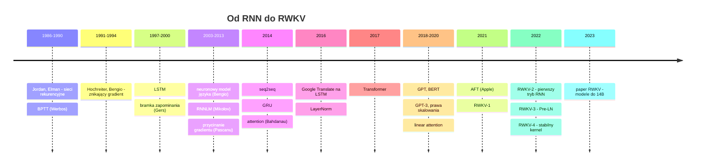

# 5. Podsumowanie: od RNN do RWKV w jednym miejscu

> Notebook do tego rozdziału: [`05_porownanie.ipynb`](05_porownanie.ipynb). Zbiera wyniki z notebooków 00–04
> i rysuje je na wspólnych wykresach (trzeba najpierw uruchomić tamte notebooki).

## 5.1. Oś czasu

## 5.2. Cztery architektury w jednej tabeli

| | RNN | LSTM | Transformer | RWKV-4 |
|---|---|---|---|---|
| mieszanie w czasie | $h_t = \tanh(W x_t + U h_{t-1})$ | bramki + stan komórki | softmax attention | WKV: średnia ważona z zanikiem $e^{-w}$ |
| zależność od przeszłości | nieliniowa, przez macierz | nieliniowa, przez macierz | bezpośrednia, do każdego tokenu | **liniowa, element po elemencie** |
| trening równoległy po czasie | nie | nie | **tak** | **tak** |
| koszt 1 tokenu przy generowaniu | $O(d^2)$ | $O(d^2)$ | $O(d^2 + t\,d)$, rośnie | $O(d^2)$ |
| pamięć na kontekst | $d$ | $2d$ | $2 \cdot L \cdot t \cdot d$ (KV cache) | $5 \cdot L \cdot d$ |
| dostęp do dalekiej przeszłości | słaby (znikający gradient) | lepszy (setki kroków) | pełny, bezstratny | dobry, ale przez stały stan (stratny) |
| główny problem | gradient, sekwencyjność | sekwencyjność | $O(T^2)$, KV cache | stała pojemność stanu, kolejność w prompcie |

## 5.3. Jak stabilizowano trening: wszystkie triki w jednym miejscu

| problem | rozwiązanie | pojawia się w |
|---|---|---|
| eksplodujący gradient | przycinanie normy gradientu | RNN, LSTM, Transformer, RWKV (wszędzie) |
| znikający gradient w czasie | addytywna aktualizacja stanu + bramki | LSTM ($c_t = f c_{t-1} + i g$) |
| | brak rekurencji, ścieżka $O(1)$ | Transformer |
| | liniowa rekurencja ze znormalizowaną średnią (softmax po czasie) | RWKV |
| znikający gradient w głąb | połączenia rezydualne | Transformer, RWKV (i LSTM "w czasie") |
| niestabilne aktywacje | LayerNorm, potem Pre-LN zamiast Post-LN | Transformer, RWKV-3/4 |
| zły start optymalizacji | bias bramki zapominania = 1 | LSTM |
| | mała inicjalizacja projekcji wyjściowych | GPT |
| | zerowa inicjalizacja, bloki startują jako tożsamość | RWKV |
| | Small Init Embedding + LayerNorm po embeddingu | RWKV |
| | "fancy init" spektrum zaników po kanałach i warstwach | RWKV-3/4 |
| stan może wybuchnąć | parametryzacja $e^{-w}$ z $w = e^{\text{raw}} > 0$ | RWKV-2+ |
| overflow $e^{k}$ | obcinanie $k \le 60$ (hack) → śledzenie wykładnika (log-sum-exp) | RWKV-2/3 → RWKV-4 |
| dryf logitów w niskiej precyzji | pomocnicza strata typu z-loss (PaLM), `L2Wrap` | RWKV-4 |
| saturacja softmaksa | skalowanie $1/\sqrt{d_k}$ | Transformer |
| niestabilny początek treningu | rozgrzewka learning rate (*warmup*) | Transformer (i nasz wspólny trening) |

## 5.4. Najważniejsze myśli, które warto wynieść

1. **Ciało modelu jest wymienne.** Tokeny, embeddingi, warstwa wyjściowa i funkcja straty są takie same dla RNN,
   Transformera i RWKV. Różni się tylko sposób, w jaki informacja płynie w czasie.
2. **Nieliniowa rekurencja = brak równoległości.** Dopóki $h_t$ zależy od $h_{t-1}$ przez macierz i nieliniowość,
   trening musi iść krok po kroku.
3. **Liniowa rekurencja to furtka.** Jeśli stan aktualizuje się liniowo, ze stałym zanikiem i element po elemencie,
   to tę samą rzecz można policzyć jako RNN (tanio w generowaniu), jako attention (równolegle w treningu)
   albo blokami (kompromis). To jest sedno RWKV.
4. **Stała pamięć ma cenę.** Model ze stanem o stałym rozmiarze nie zapamięta wszystkiego. Transformer płaci
   za bezstratną pamięć rosnącym KV cache. To kompromis, a nie błąd któregoś z podejść.
5. **Stabilność treningu to w dużej mierze inżynieria**: inicjalizacja, normalizacja, parametryzacja (np. $e^{-e^{x}}$),
   numeryka (log-sum-exp). RWKV jest tu dobrym studium przypadku.

## 5.5. Co dalej

Kolejne kroki w historii RWKV (do omówienia w następnej części):

- **RWKV-5 "Eagle"**: wiele głów i stan w postaci macierzy (jak w linear attention), czyli większa pojemność pamięci.
- **RWKV-6 "Finch"**: zanik i token shift **zależne od danych**, przy zachowaniu równoległego treningu.
- **RWKV-7 "Goose"**: jeszcze ogólniejsza reguła aktualizacji stanu (*delta rule*).

Równolegle rozwijała się cała rodzina "nowoczesnych RNN-ów" o tym samym rdzeniu (liniowa rekurencja +
trening równoległy): S4, Mamba, RetNet, GLA, LRU. RWKV był jednym z pierwszych, który pokazał, że to
skaluje się do miliardów parametrów.

**Wróć do:** [README](README.md)
